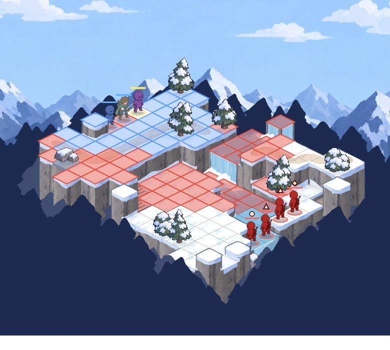
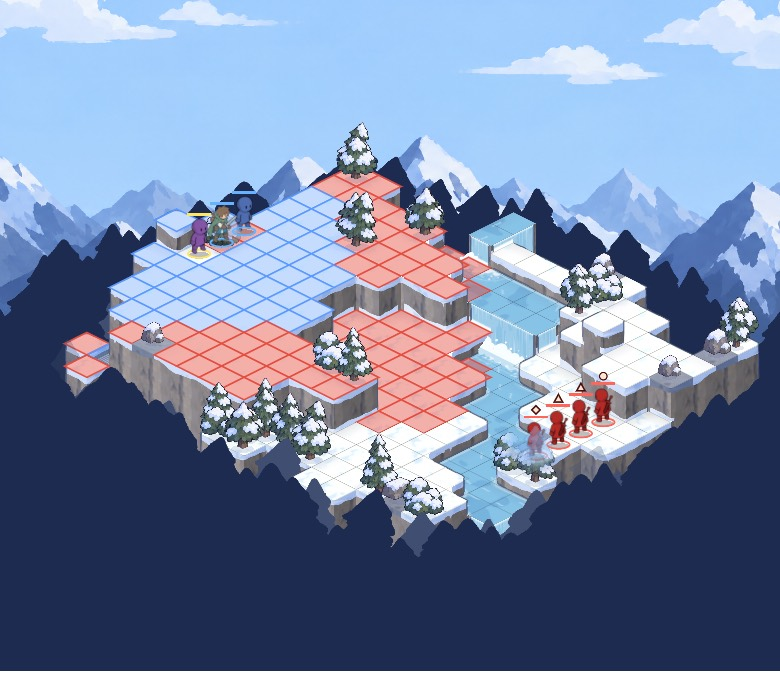
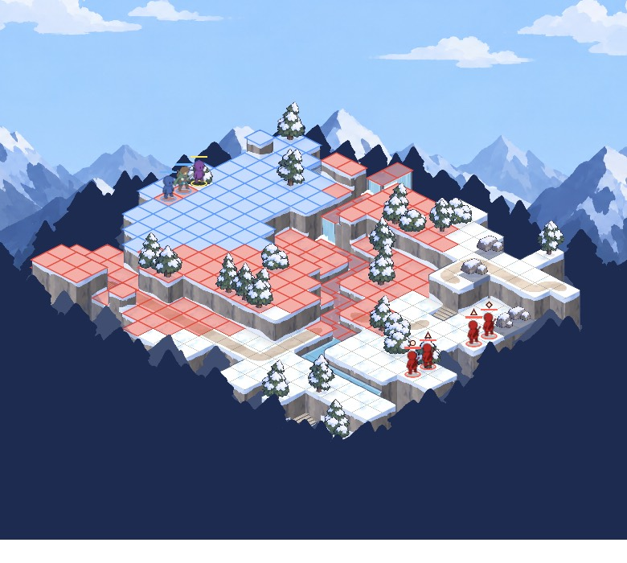

# Map size, move and reach: a study

Systems developer, 2026-10-30, for Brandon's ask in the Studio chat: are the fight areas squished, and should move and ranged reach grow with them. Nothing shipped changed: the scaled numbers live only inside the study's own process. Everything here is measured with the AI sim, headless, 100 fights per cell.

Rerun it with `tools/mem_guard.sh /Applications/Godot.app/Contents/MacOS/Godot --headless --path game -s res://tools/scale_study.gd -- 100` (about 8 minutes). Screenshots come from `tools/godot.sh --path game --script res://tools/scale_shot.gd -- <png> <today|a|b|c>`.

## What is measured

- **Start gap**: the fewest tiles between any party piece and any foe when the fight starts (`CombatRules.dist`).
- **Rounds to contact**: the first round in which anyone has lost HP. Both sides move and act in a round, so 1.0 means someone hit on the first turn.
- **Win %**: the party wins. The party is level 1: the hero (sword) and the dog for the "duo", and the hero, dog, wizard and hunter for the "four". The foes are the road encounters in `data/encounters.csv`.
- **Close %**: a win in which a party piece went down, or the party ended under 40% of its total HP.
- **Stalls %**: no winner in 40 rounds.
- Road fights use `MapGen.valley` with the party on its deploy cells at one end and the foes at the other, party first, as the fight scene does (14 x 12 with an art set).

## Part 1: today's numbers

## Units today

| class | HP | move | jump | basic reach | longest ability reach  threat, move + basic reach |
| --- | --- | --- | --- | --- | --- | --- |
| ambusher | 12 | 5 | 2 | 1-1 | 1  6 |
| archer | 9 | 4 | 2 | 2-5 | 5  9 |
| bandit | 9 | 4 | 1 | 1-1 | 1  5 |
| bandit_archer | 8 | 4 | 1 | 2-5 | 5  9 |
| bush | 12 | 2 | 1 | 1-1 | 1  3 |
| dog | 15 | 5 | 2 | 1-1 | 1  6 |
| duo | 18 | 4 | 1 | 1-1 | 1  5 |
| hunter | 10 | 5 | 2 | 2-5 | 5  10 |
| ice_pillar | 6 | 0 | 0 | 1-1 | 1  1 |
| job_archer | 18 | 4 | 1 | 1-1 | 1  5 |
| job_chanter | 17 | 4 | 1 | 1-1 | 3  5 |
| job_ember | 14 | 3 | 1 | 2-3 | 4  6 |
| job_knight | 22 | 4 | 1 | 1-1 | 1  5 |
| job_mage | 16 | 4 | 1 | 1-1 | 4  5 |
| job_mender | 15 | 3 | 1 | 1-2 | 3  5 |
| job_moon | 14 | 3 | 1 | 2-3 | 3  6 |
| job_reaver | 20 | 4 | 1 | 1-1 | 3  5 |
| job_rogue | 18 | 4 | 1 | 1-1 | 1  5 |
| job_tinker | 16 | 4 | 1 | 2-3 | 3  7 |
| job_tracker | 18 | 4 | 1 | 1-1 | 4  5 |
| knight | 14 | 4 | 1 | 1-1 | 1  5 |
| lich | 38 | 3 | 1 | 1-2 | 4  5 |
| lich_minion | 6 | 3 | 1 | 1-1 | 1  4 |
| mage | 8 | 4 | 1 | 2-3 | 3  7 |
| nobody | 20 | 4 | 1 | 1-1 | 1  5 |
| strange_thing | 12 | 3 | 3 | 1-2 | 2  5 |
| wizard | 8 | 3 | 1 | 2-3 | 4  6 |
| wolf | 7 | 6 | 2 | 1-1 | 1  7 |

## Fight areas today

| area | size | note |
| --- | --- | --- |
| road fight (a snow valley, `MapGen.valley`) | 14 x 12 | the fight scene's size when the map has an art set |
| generated fallback (`CombatGrid.generate`) | 10 x 8 | when there is no art set |
| default valley of the map maker | 22 x 20 | `MapGen.valley` default |
| explore map `city_proto` | 44 x 44 | 0 enemy groups |
| explore map `crypt` | 34 x 30 | 4 enemy groups |
| explore map `home` | 8 x 7 | 0 enemy groups |
| explore map `house_dog` | 8 x 7 | 0 enemy groups |
| explore map `house_ne` | 11 x 9 | 0 enemy groups |
| explore map `snow_pass` | 38 x 38 | 2 enemy groups |
| explore map `tavern` | 12 x 11 | 0 enemy groups |
| explore map `village` | 40 x 38 | 0 enemy groups |
| explore map `village_v2` | 56 x 56 | 0 enemy groups |
| explore map `wolf_den` | 14 x 12 | 2 enemy groups |

## Explore-map fights today (hero with a sword and the dog, level 1)

| map | group | start | start gap | rounds to contact | win % | stalls % |
| --- | --- | --- | --- | --- | --- | --- | --- |
| snow_pass | pass_wolves | party | 8.0 | 1.0 | 100 | 0 |
| snow_pass | pass_wolves | ambushed | 4.0 | 1.0 | 100 | 0 |
| snow_pass | pass_bandits | party | 6.0 | 1.0 | 100 | 0 |
| snow_pass | pass_bandits | ambushed | 6.0 | 1.0 | 100 | 0 |
| wolf_den | den_wolves | party | 7.0 | 1.0 | 98 | 0 |
| wolf_den | den_wolves | ambushed | 2.0 | 1.0 | 100 | 0 |
| wolf_den | den_lone | party | 9.0 | 1.0 | 100 | 0 |
| wolf_den | den_lone | ambushed | 3.0 | 1.0 | 100 | 0 |
| crypt | plaza | party | 6.0 | 1.0 | 98 | 0 |
| crypt | plaza | ambushed | 2.0 | 1.0 | 99 | 0 |
| crypt | cave | party | 7.0 | 1.0 | 100 | 0 |
| crypt | cave | ambushed | 4.0 | 1.0 | 100 | 0 |
| crypt | tower | party | 3.0 | 1.0 | 100 | 0 |
| crypt | tower | ambushed | 1.0 | 1.0 | 100 | 0 |
| crypt | throne | party | 4.0 | 1.0 | 0 | 0 |
| crypt | throne | ambushed | 4.0 | 1.0 | 0 | 0 |

## Scale today (valley 14 x 12)

| party | foes | start gap | rounds to contact | win % | close % | stalls % | rounds |
| --- | --- | --- | --- | --- | --- | --- | --- | --- |
| duo | pair_wolves | 11.2 | 2.2 | 100 | 30 | 0 | 4.0 |
| duo | pair_bandits | 11.2 | 1.8 | 100 | 27 | 0 | 6.7 |
| four | bandits | 11.1 | 1.3 | 100 | 6 | 0 | 3.4 |
| four | wolves | 11.1 | 1.5 | 100 | 11 | 0 | 2.8 |
| four | strange | 11.1 | 1.5 | 100 | 46 | 0 | 4.8 |
| four | debug | 11.1 | 1.3 | 100 | 13 | 0 | 3.3 |

## Scale A: area x1.25, move and reach x1.25 (valley 18 x 15)

| party | foes | start gap | rounds to contact | win % | close % | stalls % | rounds |
| --- | --- | --- | --- | --- | --- | --- | --- | --- |
| duo | pair_wolves | 15.2 | 2.2 | 100 | 36 | 0 | 4.1 |
| duo | pair_bandits | 15.2 | 2.0 | 100 | 33 | 0 | 6.5 |
| four | bandits | 15.0 | 1.6 | 100 | 6 | 0 | 3.4 |
| four | wolves | 15.0 | 1.7 | 100 | 5 | 0 | 2.7 |
| four | strange | 15.0 | 1.7 | 98 | 47 | 0 | 5.0 |
| four | debug | 15.0 | 1.6 | 100 | 12 | 0 | 3.2 |

## Scale B: area x1.5, move and reach x1.5 (valley 21 x 18)

| party | foes | start gap | rounds to contact | win % | close % | stalls % | rounds |
| --- | --- | --- | --- | --- | --- | --- | --- | --- |
| duo | pair_wolves | 18.2 | 2.3 | 100 | 48 | 0 | 4.3 |
| duo | pair_bandits | 18.2 | 2.1 | 100 | 43 | 0 | 6.8 |
| four | bandits | 18.1 | 1.6 | 100 | 5 | 0 | 3.7 |
| four | wolves | 18.1 | 1.6 | 100 | 14 | 0 | 2.9 |
| four | strange | 18.1 | 1.6 | 99 | 47 | 0 | 4.5 |
| four | debug | 18.1 | 1.5 | 100 | 5 | 0 | 3.4 |

## Scale C: area x1.5, most x1.25, fast and long-range x1.5 (valley 21 x 18)

| party | foes | start gap | rounds to contact | win % | close % | stalls % | rounds |
| --- | --- | --- | --- | --- | --- | --- | --- | --- |
| duo | pair_wolves | 18.2 | 2.3 | 100 | 54 | 0 | 4.5 |
| duo | pair_bandits | 18.2 | 2.2 | 100 | 66 | 0 | 8.1 |
| four | bandits | 18.1 | 1.6 | 100 | 6 | 0 | 4.0 |
| four | wolves | 18.1 | 1.6 | 100 | 20 | 0 | 3.2 |
| four | strange | 18.1 | 1.6 | 99 | 48 | 0 | 5.3 |
| four | debug | 18.1 | 1.6 | 100 | 6 | 0 | 3.8 |

Reading it: the fastest foe is the wolf (move 6, jump 2), then the dog, hunter and ambusher (move 5). Most pieces walk 4, casters 3, and the bush walks 2. Ranged reach tops out at 5 (the archers and the hunter); spells reach 3 to 4. Melee reach is always 1. A piece that walks and then hits threatens move + reach tiles in its first turn: 5 for a knight or bandit, 7 for the wolf, 9 for an archer.

On a road fight the start gap is 11, so a melee piece needs three rounds of walking to meet a foe walking back, while an archer (threat 9) is already in reach of the foes' front by round 2. On the explore maps the groups are met at gaps of 1 to 9 and someone always hits in the first round. The explore maps themselves are 34 x 30 (the crypt) to 56 x 56, far bigger than the road valley, but a fight there starts where the walk met the group, so the fight is as tight as the gap, not the map.

Two numbers stand out for the "squished" feeling: the road valley is 14 x 12 with a gap of 11 (so two to three rounds of walking), and the explore-map gaps are mostly under a single move plus a reach, so there is no approach phase at all.

## Part 2: three scales

All scales grow the valley and stretch the pieces on both sides: move and ranged reach (basic and every ability with a range over 1) are multiplied and rounded to the nearest tile, melee reach and jump stay as they are.

| scale | valley | most pieces | fast (move 5 or more) and long-range (reach 4 or more) |
| --- | --- | --- | --- |
| today | 14 x 12 | as is | as is |
| A | 18 x 15 (x1.25) | x1.25 | x1.25 |
| B | 21 x 18 (x1.5) | x1.5 | x1.5 |
| C | 21 x 18 (x1.5) | x1.25 | x1.5 |

Resulting numbers for a few pieces:

| piece | today | A | B | C |
| --- | --- | --- | --- | --- |
| knight or bandit, move | 4 | 5 | 6 | 5 |
| wizard, move / reach | 3 / 2-3 | 4 / 2-4 | 5 / 2-5 | 4 / 2-4 |
| wolf, move | 6 | 8 | 9 | 9 |
| dog or hunter, move | 5 | 6 | 8 | 8 |
| archer or hunter, reach | 2-5 | 2-6 | 2-8 | 2-8 |

### Scale today (valley 14 x 12)

| party | foes | start gap | rounds to contact | win % | close % | stalls % | rounds |
| --- | --- | --- | --- | --- | --- | --- | --- | --- |
| duo | pair_wolves | 11.2 | 2.2 | 100 | 30 | 0 | 4.0 |
| duo | pair_bandits | 11.2 | 1.8 | 100 | 27 | 0 | 6.7 |
| four | bandits | 11.1 | 1.3 | 100 | 6 | 0 | 3.4 |
| four | wolves | 11.1 | 1.5 | 100 | 11 | 0 | 2.8 |
| four | strange | 11.1 | 1.5 | 100 | 46 | 0 | 4.8 |
| four | debug | 11.1 | 1.3 | 100 | 13 | 0 | 3.3 |

### Scale A: area x1.25, move and reach x1.25 (valley 18 x 15)

| party | foes | start gap | rounds to contact | win % | close % | stalls % | rounds |
| --- | --- | --- | --- | --- | --- | --- | --- | --- |
| duo | pair_wolves | 15.2 | 2.2 | 100 | 36 | 0 | 4.1 |
| duo | pair_bandits | 15.2 | 2.0 | 100 | 33 | 0 | 6.5 |
| four | bandits | 15.0 | 1.6 | 100 | 6 | 0 | 3.4 |
| four | wolves | 15.0 | 1.7 | 100 | 5 | 0 | 2.7 |
| four | strange | 15.0 | 1.7 | 98 | 47 | 0 | 5.0 |
| four | debug | 15.0 | 1.6 | 100 | 12 | 0 | 3.2 |

### Scale B: area x1.5, move and reach x1.5 (valley 21 x 18)

| party | foes | start gap | rounds to contact | win % | close % | stalls % | rounds |
| --- | --- | --- | --- | --- | --- | --- | --- | --- |
| duo | pair_wolves | 18.2 | 2.3 | 100 | 48 | 0 | 4.3 |
| duo | pair_bandits | 18.2 | 2.1 | 100 | 43 | 0 | 6.8 |
| four | bandits | 18.1 | 1.6 | 100 | 5 | 0 | 3.7 |
| four | wolves | 18.1 | 1.6 | 100 | 14 | 0 | 2.9 |
| four | strange | 18.1 | 1.6 | 99 | 47 | 0 | 4.5 |
| four | debug | 18.1 | 1.5 | 100 | 5 | 0 | 3.4 |

### Scale C: area x1.5, most x1.25, fast and long-range x1.5 (valley 21 x 18)

| party | foes | start gap | rounds to contact | win % | close % | stalls % | rounds |
| --- | --- | --- | --- | --- | --- | --- | --- | --- |
| duo | pair_wolves | 18.2 | 2.3 | 100 | 54 | 0 | 4.5 |
| duo | pair_bandits | 18.2 | 2.2 | 100 | 66 | 0 | 8.1 |
| four | bandits | 18.1 | 1.6 | 100 | 6 | 0 | 4.0 |
| four | wolves | 18.1 | 1.6 | 100 | 20 | 0 | 3.2 |
| four | strange | 18.1 | 1.6 | 99 | 48 | 0 | 5.3 |
| four | debug | 18.1 | 1.6 | 100 | 6 | 0 | 3.8 |

## What the numbers say

- **The gap grows with the area, but so does the walk.** The start gap goes 11 to 15 to 18, and gap divided by a knight's move stays near 2.75 (today), 3.0 (A) and 3.0 (B). So scaling everything together changes how large the board looks, not how many rounds the walk takes: rounds to contact rise by about a tenth to a third of a round (duo vs bandits 1.8, 2.0, 2.1, 2.2).
- **C is the only scale that changes the shape.** The knight takes 3.6 rounds to cross (18 / 5) but the wolf 2.0 (18 / 9) and an archer threatens 13 tiles (5 to walk, 8 of reach) of the 18, so the fast and long-range pieces get there well before the rest. That is the "speed and range feel significant" case, and it is where the close-fight share moves most: duo vs bandits 27% close today, 66% in C, with fights running 8.1 rounds against 6.7.
- **Win rates barely move.** Every cell is 98 to 100% for the party at level 1, with no stalls, so none of the three scales breaks the fights. The party was already comfortably ahead in these road fights: the study says the scale is safe, not that the fights are balanced.
- **The four-piece party does not feel the scale.** Against three foes it wins in about 3 rounds at every scale, close share 5 to 20% except the strange group (about 47% close at every scale, so that is the foes, not the size).
- **The duo does.** The pair fights get closer as pieces spread out: pair_wolves 30%, 36%, 48%, 54% close. Wolves reach the hero and dog faster than the party can focus them, which is the more dangerous shape for a small party.
- **Jump did not scale.** Terrain heights are the same in all scales, so a bigger valley with the same cliffs can leave a faster piece stuck behind a ledge it cannot climb (the screenshots show the hunter's move range stopping at the cliff edges). If the move grows, jump 1 pieces may want a look.
- **Not measured.** The explore maps and the hand-made battle maps are fixed JSON, so they were not scaled; only the generated valley was. The AI always closes the distance, so the sim cannot say whether the walk feels long to a player: that is the screenshots and Brandon's eye.

## Screenshots

Same generator seed in each (the valley is seeded per size, so the terrain differs between sizes), the hunter selected: blue is where it can walk, red is every tile it could hit from somewhere it could walk to.

| today (14 x 12, move 5, reach 2-5) | A (18 x 15, move 6, reach 2-6) |
| --- | --- |
|  |  |

| B (21 x 18, move 8, reach 2-8) | C (21 x 18, move 8, reach 2-8, the rest x1.25) |
| --- | --- |
|  |  |

(The hunter is already "fast and long" so B and C show it the same; C's difference is the other pieces, who walk 5 instead of 6.)

## Scale C test fight (2026-10-30)
Launch screen, FIGHT column, "Scale C test": the 21 x 18 arena (`data/maps/arena_c.json`), a knight (move 5, melee), a fast rogue (move 8) and a slow ranged mage (move 4, spells to 6 tiles) against five foes (three bandits at move 5, an archer reaching 8, a wolf at move 9). The numbers are `data/scale_c.csv`, laid over the pieces only for this fight (`ScaleTest`); shipped classes and maps are unchanged. Screenshot: `tools/godot.sh --path game --script res://tools/scale_test_shot.gd -- <png> [piece]`.

## Scale C as the standard: ready to switch (2026-10-30)
Brandon picked scale C on `design-scale`. The numbers for every class and ranged ability are in `game/data/scale_standard.csv`, made by the study's rule (move and ranged reach x1.25; a base move of 5 or more, or a reach of 4 or more, x1.5; melee reach 1 and jump unchanged), and applied by `ScaleTest.standard` to each piece as it is built. The switch is `scale_standard` in `game/data/combat.csv`, **0 for now**: flip it to 1 once the fight areas are resized (the road valley 14 x 12 becomes 21 x 18, `CombatScene`'s `MapGen.valley` call, and the map builder's fixed maps). With it on, a knight walks 5, the dog and hunter 8, the wolf 9, the archers reach 8, the mage's fire reaches 6. For the map makers: the walk across a fight area is about 3 rounds for a regular piece on a 21 x 18 board, 2 for the fast ones.

### Switched on (2026-10-30)
`scale_standard` is 1 in `game/data/combat.csv`: every piece's move and reach are scale C's, on the road fights (21 x 18) and on the explore maps (not resized). Re-measured once with `tools/explore_balance.gd -- 40 <level> <weapon> <0|1>` (the last number forces the switch), hero and dog, party first and ambushed; the road fights are now 21 x 18.

| fight | off | on |
| --- | --- | --- |
| road, pair of wolves, level 1 and 5 | 100%, no stalemates | 100%, no stalemates |
| road, pair of bandits, level 1 | 100% | 98% |
| snow pass bandits, level 1, ambushed | 100% | 93% |
| other explore groups, level 1 and 5 | 98 to 100% | 100% (rounds fall by 0 to 3, a round or two on the plaza and tower) |
| the Lich, level 5, sword (party first / ambushed) | 48% / 43% | 48% / 25% |
| the Lich, level 5, book | 83% / 93% | 83% / 93% |
| the Lich, level 1 (any weapon) | 0% | 0% |

Nothing stalls. The one clear loss is the ambushed Lich with the sword (43 to 25%): his foes and pillars reach further now. The unit tests run with the switch paused (`ScaleTest.PAUSE_META`), since they were written for the old numbers; the E2E robot plays with it on and passes.
